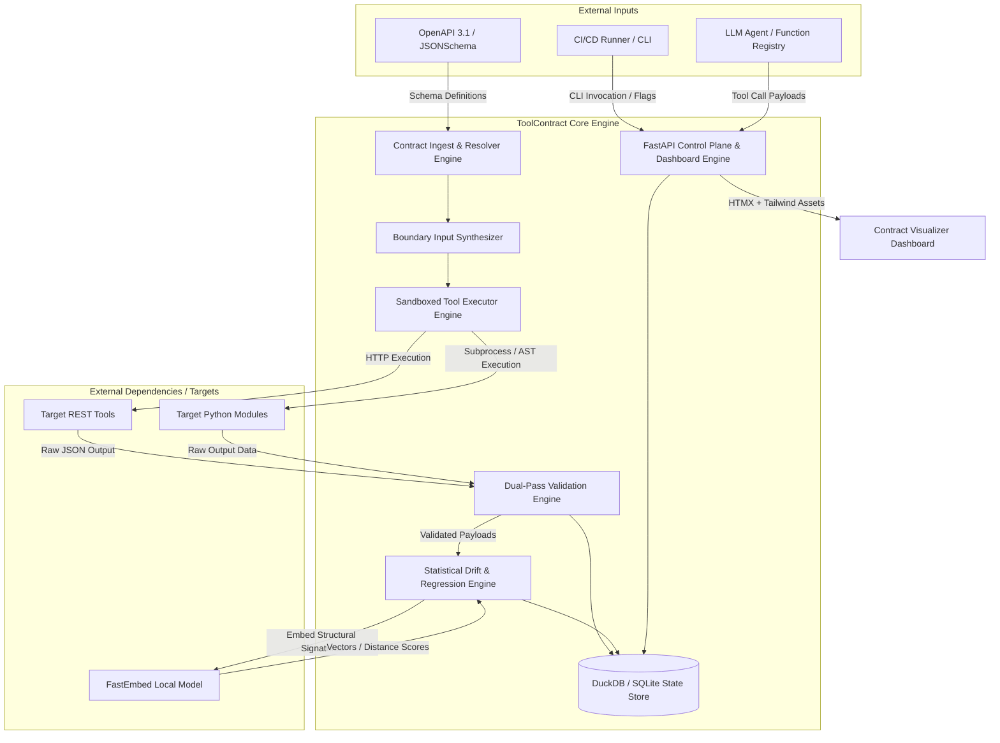
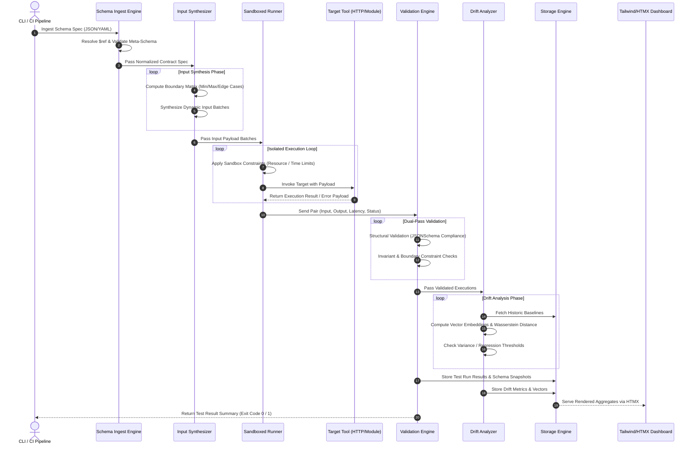

# ToolContract Validator — Architecture Specification

## 1. High-Level System Topology

ToolContract Validator is an enterprise-grade automated contract-testing harness designed for AI agents, dynamic tool execution engines, and structured LLM function calling pipelines. It synthesizes boundary inputs using constraint satisfaction algorithms, executes tools within an isolated boundary, verifies schema conformance against strict JSONSchema/OpenAPI specs, and detects non-deterministic structural or semantic regression drift over time.

### 1.1 System Context Diagram



### 1.2 Core Subsystems

1. **Ingest & Resolution Engine**: Parsers OpenAPI 3.0/3.1 specifications and standalone JSONSchema documents into normalized Pydantic v2 internal models, resolving `$ref` pointers and nested allOf/oneOf/anyOf constructs.
2. **Boundary Input Synthesizer**: Integrates property-based testing principles (via Z3 constraint solving and Hypothesis algorithms) to auto-generate valid, edge-case, and boundary payloads (e.g., null bytes, numeric overflows, string pattern limits, schema-violating types).
3. **Sandboxed Tool Executor**: Executes local Python callable tools or remote HTTP endpoints in resource-constrained sub-processes or isolated network contexts with strict timeouts and memory boundaries.
4. **Dual-Pass Validation Engine**: Performs structural JSONSchema validation alongside type coercion checks, validating outputs against the schema, verifying missing fields, additional properties violations, and type mismatches.
5. **Statistical Drift Engine**: Calculates structural entropy and semantic drift across execution histories using local embedding models (`FastEmbed`) and Wasserstein distance metrics to detect silent LLM tool behavior changes.
6. **Control Plane & Visualizer**: A light FastAPI server rendering an interactive Tailwind CSS + HTMX single-page visualization dashboard and serving CLI/REST endpoints.

---

## 2. Tech Stack Rationale

The system adheres strictly to a **70% Battle-Tested / 30% Bleeding-Edge** operational ratio to balance deterministic stability with state-of-the-art constraint generation and drift detection.

| Component | Technology | Category | Architectural Rationale |
| :--- | :--- | :--- | :--- |
| **Language** | Python 3.11+ | Battle-Tested | Native support for modern typing (`Self`, `TypeVarTuple`), performance improvements via adaptive interpreter, and deep ecosystem support for AI tooling. |
| **Data Parsing & Schemas** | Pydantic v2 | Battle-Tested | Core compiled Rust validation engine (`pydantic-core`). Delivers up to 20x performance speedup for schema serialization, custom validators, and JSON schema parsing. |
| **API Framework** | FastAPI | Battle-Tested | Async-native OpenAPI endpoint generation, minimal overhead, direct integration with Pydantic v2 objects. |
| **Persistence Layer** | DuckDB + SQLite | Battle-Tested | SQLite for fast stateful transactional data; DuckDB for high-throughput OLAP execution history queries and statistical drift computing without external database daemons. |
| **Synthesis Engine** | Hypothesis + Z3 Solver | Bleeding-Edge | Dynamic input synthesis using formal logic constraint solving for auto-generating contract boundary payloads from complex JSONSchemas. |
| **Semantic Drift Engine** | FastEmbed (ONNX Run) | Bleeding-Edge | Lightweight, C++ CPU-optimized embedding generation (FlagEmbedding) without PyTorch overhead for running localized semantic cosine/Wasserstein distance metrics. |
| **UI Visualizer** | HTMX + Tailwind CSS | Bleeding-Edge | Zero-JavaScript-framework asset generation. Renders server-side HTML directly from FastAPI templates with responsive, tailwind-designed UI components. |
| **CLI Framework** | Typer | Battle-Tested | Type-safe CLI generation based on standard Python type annotations, matching Pydantic paradigms. |

---

## 3. Module & Directory Layout

```
toolcontract-validator/
├── README.md
├── pyproject.toml
├── ARCHITECTURE.md
├── docker-compose.yml
├── Dockerfile
├── src/
│   └── toolcontract/
│       ├── __init__.py
│       ├── main.py
│       ├── py.typed
│       ├── cli/
│       │   ├── __init__.py
│       │   ├── entrypoint.py
│       │   ├── commands_test.py
│       │   ├── commands_schema.py
│       │   └── formatting.py
│       ├── core/
│       │   ├── __init__.py
│       │   ├── config.py
│       │   ├── exceptions.py
│       │   └── types.py
│       ├── schema/
│       │   ├── __init__.py
│       │   ├── parser.py
│       │   ├── resolver.py
│       │   ├── models.py
│       │   └── static_analysis.py
│       ├── synthesis/
│       │   ├── __init__.py
│       │   ├── engine.py
│       │   ├── boundary_rules.py
│       │   ├── strategies.py
│       │   └── mutators.py
│       ├── execution/
│       │   ├── __init__.py
│       │   ├── runner.py
│       │   ├── sandbox.py
│       │   ├── http_adapter.py
│       │   └── python_adapter.py
│       ├── validation/
│       │   ├── __init__.py
│       │   ├── validator.py
│       │   ├── structural.py
│       │   ├── semantic.py
│       │   └── reporting.py
│       ├── drift/
│       │   ├── __init__.py
│       │   ├── analyzer.py
│       │   ├── embeddings.py
│       │   └── metrics.py
│       ├── storage/
│       │   ├── __init__.py
│       │   ├── db.py
│       │   ├── repository.py
│       │   └── models.py
│       └── server/
│           ├── __init__.py
│           ├── app.py
│           ├── routes/
│           │   ├── __init__.py
│           │   ├── api_contracts.py
│           │   ├── api_runs.py
│           │   └── dashboard.py
│           ├── templates/
│           │   ├── base.html
│           │   ├── dashboard.html
│           │   └── components/
│           │       ├── contract_card.html
│           │       ├── run_table.html
│           │       └── drift_chart.html
│           └── static/
│               ├── css/
│               │   └── tailwind.css
│               └── js/
│                   └── htmx.min.js
└── tests/
    ├── unit/
    │   ├── test_schema_parser.py
    │   ├── test_synthesis.py
    │   ├── test_validator.py
    │   └── test_drift.py
    ├── integration/
    │   ├── test_runner_sandbox.py
    │   └── test_storage.py
    └── e2e/
        ├── test_cli_workflow.py
        └── test_server_api.py
```

### 3.1 Detailed Module Specifications

#### `toolcontract.schema`
*   `parser.py`: Ingests JSON/YAML files or raw dict specs. Normalizes schemas into canonical `ContractSpec` models.
*   `resolver.py`: Resolves inline (`#/$defs/`) and external (`https://` / relative file) JSON references.
*   `models.py`: Defines immutable Pydantic models representing expected input schemas, output schemas, HTTP target definitions, and performance invariants.
*   `static_analysis.py`: Computes schema complexity index, structural breadth, depth, and potential ambiguity (e.g., untyped `object` nodes).

#### `toolcontract.synthesis`
*   `engine.py`: Coordinates generation strategy for target tool inputs using Hypothesis-driven strategies.
*   `boundary_rules.py`: Contains boundary condition generators (e.g., min/max boundaries for numbers, string length limits, empty arrays, unicode edge cases, SQL/XSS boundary patterns).
*   `strategies.py`: Maps JSON Schema primitive types (`string`, `integer`, `number`, `boolean`, `array`, `object`) to specialized generation pipelines.
*   `mutators.py`: Introduces schema invalidity perturbations (e.g., removing required keys, mutating types) to verify negative validation paths.

#### `toolcontract.execution`
*   `runner.py`: Orchestrates execution against synthesized input batches. Handles concurrent async scheduling.
*   `sandbox.py`: Enforces process-level sandboxing (CPU time limits, memory caps using `resource` module, isolated working directories).
*   `http_adapter.py`: Translates synthesized inputs to REST call parameters (Headers, Path Params, Body).
*   `python_adapter.py`: Safely imports and executes local Python functions via isolated worker pools.

#### `toolcontract.validation`
*   `validator.py`: Executes standard validation pipeline on payload outputs.
*   `structural.py`: Uses high-performance JSON Schema engines (`referencing` + `jsonschema`) to validate type conformance, strict enum matches, and required field existence.
*   `semantic.py`: Checks semantic bounds (e.g., non-empty strings where descriptive text is required, logical consistency between fields).
*   `reporting.py`: Assembles structured validation reports including accurate field-path JSONPointers (`/data/items/0/id`) for failures.

#### `toolcontract.drift`
*   `analyzer.py`: Compares historic result distributions against current runs.
*   `embeddings.py`: Uses `FastEmbed` to transform structured JSON string representations into vector space.
*   `metrics.py`: Implements mathematical formulations for Jensen-Shannon Divergence, Cosine Distance, and Wasserstein Distance over result schemas.

#### `toolcontract.storage`
*   `db.py`: Initializes connection pools for DuckDB (analytics) and SQLite (transactional contract configuration).
*   `repository.py`: CRUD operations for runs, execution history, contract snapshots, and baseline performance data.

---

## 4. Data Flow & Component Interaction Pipeline

### 4.1 System Execution Flow



### 4.2 Detailed Component Interaction Pipeline

1. **Ingestion & Compilation Phase**:
   - The user executes `toolcontract run --spec schema.json --target http://localhost:8000/api/tool`.
   - `toolcontract.schema.parser` parses the input schema into an internal `ContractSpec`.
   - References ($ref) are expanded into an in-memory unified Schema Graph.

2. **Synthesis & Matrix Generation**:
   - The `SynthesisEngine` parses schema node constraints (e.g., `minimum: 0`, `maxLength: 64`, `pattern: "^[a-z]+$"`).
   - The engine generates three test classes:
     - **Nominal Class**: Standard compliant payloads.
     - **Boundary Class**: Maximum values, minimum values, null fields, single-item arrays, max-length strings.
     - **Adversarial Class**: Type mis-matches, additional illegal properties, boundary numeric overflows.

3. **Sandboxed Execution Phase**:
   - Inputs are pushed to `SandboxExecutor`.
   - For local functions: Executed inside an isolated child process via `multiprocessing` with explicit execution timeouts (`RLIMIT_CPU`, `RLIMIT_AS`).
   - For remote HTTP tools: Invoked using an async HTTP client (`httpx`) with circuit-breaker connection timeouts and resource isolation.

4. **Dual-Pass Verification**:
   - **Pass 1 (Structural)**: Output JSON is validated against expected `response_schema`. Every violation generates a detailed `ValidationError` object containing `json_path`, `expected_type`, and `given_value`.
   - **Pass 2 (Semantic Drift Analysis)**: Evaluates response metrics against historical runs loaded from `storage.repository`. If schema valid outputs undergo structural degradation (e.g., semantic drift score > limit threshold `0.15`), a non-conforming drift warning is emitted.

5. **Reporting & Persistence**:
   - Execution data is written transactionally to SQLite/DuckDB.
   - Outputs are formatted for console (Rich-based tables) or served dynamically via the FastAPI HTMX frontend.

---

## 5. Security & Boundary Isolation

Executing untrusted LLM tool outputs or invoking dynamic Python dynamic modules presents remote code execution (RCE) and system stability risks. ToolContract Validator enforces security through multi-layered defense structures.

```
       [ Input Payload ]
               │
               ▼
   ┌───────────────────────┐
   │ AST Sanitizer Engine  │  <-- Blocks unsafe imports/dunder access
   └───────────┬───────────┘
               │
               ▼
   ┌───────────────────────┐
   │ OS Resource Limits    │  <-- Memory (RLIMIT_AS), CPU (RLIMIT_CPU)
   └───────────┬───────────┘
               │
               ▼
   ┌───────────────────────┐
   │ Process Sandboxing    │  <-- Non-root, isolated execution worker
   └───────────┬───────────┘
               │
               ▼
   ┌───────────────────────┐
   │ Credential Redaction  │  <-- Regex & Entropy secret masking
   └───────────────────────┘
```

### 5.1 Process-Level Isolation Engine

Local Python tools under test are never executed within the main system process space.

```python
# System Process Security Configuration (toolcontract/execution/sandbox.py)
import resource
import os

def set_process_limits(max_memory_mb: int = 512, max_cpu_seconds: int = 5) -> None:
    """Enforces strict POSIX resource limits on worker child processes."""
    # Limit Virtual Memory allocation (AS = Address Space)
    bytes_limit = max_memory_mb * 1024 * 1024
    resource.setrlimit(resource.RLIMIT_AS, (bytes_limit, bytes_limit))
    
    # Limit Total CPU Time in seconds
    resource.setrlimit(resource.RLIMIT_CPU, (max_cpu_seconds, max_cpu_seconds))
    
    # Prevent core dumps
    resource.setrlimit(resource.RLIMIT_CORE, (0, 0))
```

### 5.2 Dynamic Code Execution Safeguards

When analyzing local Python tools via file path or callable string paths (`module.submodule:tool_function`):

1. **AST Sanitization**: Dynamic tool entrypoints undergo pre-execution static analysis via Python's `ast` module. The analysis rejects tools attempting low-level unsafe calls (e.g., `eval()`, `exec()`, raw `ctypes` bindings, or direct `sys.modules` manipulation) unless explicitly bypassed via `--unsafe-allow-ast`.
2. **Path Sandboxing**: Python workers run in isolated temporary working directories (`tempfile.TemporaryDirectory`) with read-only access to source files.

### 5.3 Payload & Secret Redaction Engine

Test traces, error logs, and persistent execution snapshots automatically sanitize sensitive payload values prior to writing to DuckDB/SQLite or sending payloads to the visualizer dashboard.

```python
# Credential Redaction Rules (toolcontract/core/config.py)
SENSITIVE_KEY_PATTERNS: set[str] = {
    "api_key", "apikey", "secret", "token", "auth", 
    "password", "bearer", "private_key", "access_token"
}

ENTROPY_THRESHOLD: float = 4.5  # High-entropy string detection flag
```

*   **Key-Based Masking**: Any JSON key matching `SENSITIVE_KEY_PATTERNS` has its value overwritten with `"[REDACTED_SECRET]"` prior to storage or telemetry emission.
*   **Entropy Scanning**: Free-form string outputs are evaluated for high Shannon entropy. Strings matching standard API key signatures (e.g., `sk-[a-zA-Z0-9]{32,}`, `ghp_[a-zA-Z0-9]{36}`) are stripped automatically.

### 5.4 HTTP Sandbox Boundaries

For HTTP target tools, the HTTP runner enforces connection boundaries:
*   **Network Timeouts**: Connect timeout = 2.0s, Read timeout = 10.0s.
*   **Localhost Protection**: Explicit option `--block-internal-ips` prevents SSRF (Server-Side Request Forgery) attacks targeting local cloud metadata services (`169.254.169.254`, `127.0.0.1`, `::1`).
*   **Payload Size Caps**: Ingress/Egress response bodies are capped at a maximum of 10 MB per test request to prevent memory exhaustion.